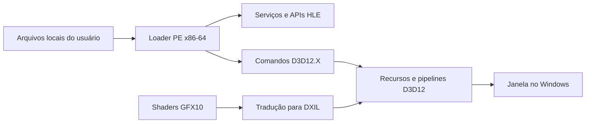

# Victory RTX 2080

Runtime experimental em Rust para executar GTA VI no Windows com uma NVIDIA RTX 2080 de 8 GB. O projeto reúne carregamento nativo de código x86-64, compatibilidade com serviços Xbox e tradução gráfica para DirectX 12, com um perfil local de execução em modo Series S.

**Estado atual:** inicialização, apresentação de conteúdo 3D e controle do personagem confirmados em uma máquina local. O desempenho ainda é muito baixo, há defeitos de renderização e ocorreram crashes. Este repositório preserva um estado recuperável de desenvolvimento; não representa uma versão estável ou uma conversão completa do jogo para PC.

## O que já foi observado

| Etapa | Resultado local |
|---|---|
| Compilação em Release | Concluída com Rust 1.98.1, MSVC e Windows SDK |
| Carregamento e imports | Executável preparado e dependências resolvidas na sessão validada |
| Janela e telas iniciais | Janela com área cliente de 1280×720 e seleção de conta visível |
| Cena 3D | Personagens, cabelo, roupas, construções, vegetação e iluminação visíveis |
| Interação | O usuário confirmou conseguir jogar; não foi validada a conclusão de uma missão |
| Desempenho | Amostras recentes entre aproximadamente 0,3 e 2,5 FPS em cenas pesadas; não é benchmark controlado |
| Estabilidade e imagem | Ainda há crashes, superfícies pretas, exposição excessiva e draws descartados |

Os 30 FPS vistos em algumas telas iniciais não correspondem ao desempenho do cenário. Não foram feitos testes comparativos em outras máquinas neste projeto.

## PC utilizado nos testes

Especificações consultadas diretamente no Windows e no driver NVIDIA em **25/11/2026**:

| Componente | Configuração |
|---|---|
| Processador | AMD Ryzen 5 5500 — 6 núcleos e 12 threads |
| Placa de vídeo | NVIDIA GeForce RTX 2080 — 8 GB de VRAM (8192 MiB) |
| Driver NVIDIA | 621.14 |
| Memória RAM | 32 GB, em 2 módulos de 16 GB; velocidade configurada informada pelo Windows: 2133 |
| Placa-mãe | ASUS PRIME B450M-GAMING/BR |
| Sistema operacional | Windows 11 Pro x64 — versão 10.0.26300, build 26300 |
| SSD do projeto e arquivos locais (`J:`) | Kingston A400, modelo SA400S37960G — SATA, aproximadamente 894 GiB |
| Segundo SSD | WDC WDS480G2G0B-00EPW0 — SATA, aproximadamente 447 GiB |
| Perfil do runtime | Series S, janela com área cliente 1280×720 |

As capacidades dos SSDs acima estão em GiB, conforme o tamanho consultado no sistema. A configuração descreve a máquina de desenvolvimento e os resultados locais; não estabelece requisitos mínimos nem garante desempenho equivalente em outro PC.

## Como o runtime funciona

O código de CPU do título já é x86-64. O loader prepara e mapeia sua imagem PE no processo do runtime, resolve imports e administra a infraestrutura necessária à execução. A adaptação principal está nas APIs, nos recursos gráficos e nos shaders do console.



O workspace separa essas responsabilidades:

| Componente | Responsabilidade no código |
|---|---|
| `apps/victory` | CLI de configuração, inspeção, tradução e execução |
| `victory-core` | Configuração, logging, caminhos e guardas para manter dados externos ao repositório |
| `victory-pe` / `victory-loader` | Estruturas PE, preparação, mapeamento, binding e diagnóstico de falhas |
| `victory-hle` | Implementações de serviços de sistema, memória, arquivos, entrada, áudio, armazenamento e operações assíncronas; cobertura parcial |
| `victory-gpu` | Objetos D3D12.X, comandos, heaps, descritores, cópias, sincronização, pipelines e apresentação em D3D12 |
| `victory-shader` | Decodificação GFX10, representação intermediária, análise de recursos e emissão DXIL |
| `victory-formats` | Layouts e conversões de formatos, incluindo texturas e áudio |
| `victory-pipeline` | Conversões e cache por conteúdo |
| `victory-game` | Identificações e integrações específicas do título |
| `xtask` | Verificação da política de arquivos do repositório |

Implementação de uma API ou formato não significa compatibilidade completa. Pipelines que falham na tradução ou são recusados pelo driver ainda podem impedir partes da imagem de aparecerem.

## Compilar

Requisitos para o runtime gráfico: Windows x64, CPU com AVX2, GPU Direct3D 12 com Shader Model 6.6 e mesh shaders para o cenário, ferramentas MSVC e Windows SDK. A versão Rust está fixada em `rust-toolchain.toml`.

```powershell
git clone https://github.com/GiovannaSGuerrera/Victory-RTX2080.git
cd Victory-RTX2080
cargo build --release --locked -p victory
```

O executável é gerado em `target\release\victory.exe`. Com as dependências já disponíveis no cache Cargo, a compilação também pode usar `--offline`.

## Configurar e executar

Crie `victory.toml` a partir de `victory.example.toml`. Ajuste os caminhos para seus arquivos, sempre fora do repositório. Separe cache de dados persistentes:

```toml
[paths]
game_dir = 'D:\VictoryLocal\game'
cache_dir = 'D:\VictoryLocal\cache'
data_dir = 'D:\VictoryLocal\data'
```

Confira a configuração antes de iniciar:

```powershell
.\target\release\victory.exe config
.\target\release\victory.exe run 'D:\VictoryLocal\game\game_scarlett_master.exe' --execute --console series-s
```

Use o executável junto ao manifesto e às dependências do pacote. Informar apenas `game_dir` não substitui o argumento do executável no comando `run`. Sem `--execute`, o comando termina depois da preparação e resolução de imports.

### Perfil local preservado

O checkpoint inclui `scripts/Start-Local.ps1`, a configuração de referência e o [registro de recuperação](docs/local-playable-checkpoint.md). Esse launcher foi feito para a estrutura local `J:\GTA6\victory-8gb`; seus caminhos devem ser ajustados antes de usá-lo em outro diretório. O comando manual acima funciona independentemente dessa organização.

As opções do perfil preservado são:

| Opção | Valor | Finalidade |
|---|---|---|
| `VICTORY_DISPLAY_MODE` | `1280x720` | Modo de saída solicitado; o launcher também verifica a área cliente da janela |
| `VICTORY_PIPELINE_SMALL_FIRST` | `1` | Prioriza pipelines menores e limita a concorrência dos computes grandes |
| `VICTORY_TEXTURE_DROP_MIPS` | `1` | Omite o maior mip de texturas elegíveis para reduzir seu tamanho no host |
| `VICTORY_SMALL_TEXTURE_KB` | `0` | Desativa a reserva adicional para admitir texturas pequenas quando a placa está cheia |
| `VICTORY_QUEUE2` | `1` | Usa uma fila de cópia dedicada para buscas do relay quando aplicável |
| `VICTORY_INDIRECT_WINDOW` | `1` | Processa argumentos de draws indiretos em janelas de registros |
| `VICTORY_ASYNC_SUBMIT` | `1` | Prepara e submete comandos por uma thread do runtime |
| `VICTORY_ASYNC_SUBMIT_SAFE` | `1` | Mantém a espera segura de leitura da memória do título |
| `VICTORY_CARD_HASH_WIDE` | `1` | Amplia o grupo de threads do passe de hash na GPU |
| `VICTORY_LATE_WAIT` | `2` | Adia esperas e reconcilia escritas conforme a política desse estágio |
| `VICTORY_BACK_SETTLE` | `0` | Seleciona a política explícita de espera da apresentação, quando aplicável |

O launcher padrão **não aplica** `VICTORY_BAKE_TEXTURES_MS=0`. Esse ajuste foi preparado para investigar pausas em texturas e ficou disponível apenas com `-ExperimentalBakeBudget`: não havia validação dele na sessão confirmada como jogável. O carregamento de texturas antes dos bake draws continua com `BAKE_FLUSH` ativo por padrão.

A opção de prioridade de pipelines foi habilitada ao mesmo tempo em que se reaproveitou um cache anterior. O aparecimento do cenário não permite atribuir a melhora exclusivamente a essa opção.

## Cache, entrada e diagnóstico

O runtime mantém traduções e uma biblioteca de pipelines para reutilização. O cache de shaders considera a identidade do tradutor; mudanças nele podem exigir nova tradução. Uma primeira execução pode levar vários minutos compilando, e um checkout do Git não contém o cache já produzido localmente.

Para pré-traduzir shaders usando a configuração escolhida:

```powershell
.\target\release\victory.exe translate 'D:\VictoryLocal\game' --cache
```

Para inspeção e validação:

```powershell
.\target\release\victory.exe inspect 'D:\VictoryLocal\game\game_scarlett_master.exe' --imports
.\target\release\victory.exe census 'D:\VictoryLocal\game' --missing
.\target\release\victory.exe translate 'D:\VictoryLocal\game' --validate --pipelines
```

A validação DXIL utiliza `dxil.dll`, indicada por `VICTORY_DXIL` ou descoberta no Windows SDK. O build de diagnóstico habilita ferramentas adicionais:

```powershell
cargo build --profile diag --locked -p victory --features diagnostics
```

Controle: gamepad XInput ou teclado como controle, quando aplicável e com a janela em foco. `Enter` corresponde a A, `Backspace` a B, `Esc` ao menu, `Tab` a View; WASD e IJKL controlam os sticks. X/Y, Q/E, Z/C e F/H completam os botões descritos no código de entrada.

## Limitações em investigação

- **Pausas em texturas:** logs registraram quadros de cerca de dois segundos, com grande parte do tempo na preparação de texturas e esperas pela memória do título.
- **Pipelines recusados:** zerar a fila de compilação não elimina falhas de criação ou draws descartados.
- **Imagem incompleta:** há exposição excessiva, regiões escuras, vegetação pontilhada e partes do cenário ausentes. Uma imagem isolada não determina se a causa é textura, shader, geometria ou sincronização.
- **Memória:** o processo e a memória compartilhada da GPU podem consumir bastante commit do Windows. A pressão de memória foi observada, mas não foi comprovada como causa única dos crashes.
- **Estabilidade:** houve uma exceção de escrita em endereço nulo (`0xC0000005`); a causa efetiva permanece sem correção confirmada.
- **Ray tracing:** o código contém suporte experimental. Não há validação local de iluminação completa por ray tracing.

Os dados do título, saves e cache ficam no computador do usuário. Este repositório contém código, ferramentas e documentação; não distribui arquivos do jogo, capturas, dumps ou executáveis do título, nem fornece chaves ou mecanismos para contornar proteções.

## Checkpoint e desenvolvimento

O estado local recuperável está marcado por `checkpoint-jogavel-2026-11-25`, com o commit `f7f765c`. O [manifesto](docs/local-playable-checkpoint.json) registra o build e o [guia](docs/local-playable-checkpoint.md) explica sua recuperação. O checkpoint do código não é um save da missão.

Verificações disponíveis no projeto:

```powershell
cargo test --workspace --locked
cargo clippy --workspace --all-targets --locked -- -D warnings
cargo run --release --locked -p xtask -- policy
```

A compilação Release, o parser do launcher, a leitura da configuração e a política de arquivos do checkpoint foram verificados localmente. Não se afirma que toda a suíte de testes ou o clippy tenham sido executados para este checkpoint.

A próxima etapa é reproduzir as falhas na mesma cena, separar custos de CPU/GPU e corrigir recursos e pipelines sem perder a referência que já apresentou conteúdo real.

## Licença e contribuições

GPL-3.0-or-later. Consulte [LICENSE](LICENSE), [CREDITS.md](CREDITS.md), [CONTRIBUTING.md](CONTRIBUTING.md) e a [política de arquivos](docs/asset-policy.md). Preserve os avisos e as atribuições ao redistribuir ou modificar o código.
