# bcpack-gpu-hlsl — Clean-Room Xbox Series BCPack (MDU rANS) Decoder in DirectX 12 HLSL SM 6.6

[](sdk/shaders/bcpack_decode.hlsl)
[%20%7C%2021%2F21%20PASS-ff4081)](#verified-bit-exactness-bcpack-gpu-demo---verify--2121-pass)
[](https://github.com/POMXARK/bcpack-gpu-sdk)
[-9b59b6)](sdk/shaders/bcpack_bc7_rans.hlsl)
[](sdk/include/bcpack_gpu.h)
[](LICENSE-MIT)


- **Full HD (`1920×1080`) Captures:** [`60 FPS MP4`](media/aaa_benchmark_60fps.mp4) | [`120 FPS MP4`](media/aaa_benchmark_120fps.mp4) | [`240 FPS MP4`](media/aaa_benchmark_240fps.mp4) | [`Unlimited (MAX) MP4`](media/aaa_benchmark_unlimited.mp4) | [`3-Act 8s Overview GIF`](media/aaa_showcase_v8.gif)

**Full 4K AAA GPU-streaming showcase, 12.41M Mesh-Shader demo, and 19-test verification harness built on top of the standalone clean-room SDK [`POMXARK/bcpack-gpu-sdk`](https://github.com/POMXARK/bcpack-gpu-sdk) (linked via Git submodule at [`sdk/`](sdk)).**

> Want only the lightweight, zero-bloat C-ABI DLL (`bcpack_gpu.dll`), `bcpack_gpu.h`, HLSL/DXIL compute kernels, and **Vulkan 1.3 SPIR-V (`.spv`)** binaries? Use **[`POMXARK/bcpack-gpu-sdk`](https://github.com/POMXARK/bcpack-gpu-sdk)** directly!
> Clean-room implementation (`MIT OR Apache-2.0`) using **100% open synthetic and procedurally generated `.bcpack` assets** — zero copyrighted or proprietary game data. AI/LLM spec: [`docs/AI_ARCHITECTURE.md`](docs/AI_ARCHITECTURE.md) & [`llms.txt`](llms.txt).

---

## What's New in `v0.11.0` — Low-VRAM Scaling, TAAU Upscaler & Hardware VRS Tier 2

Built for 8 GB / budget GPUs (`RTX 3060 / 4060 / RX 6600 / iGPU`) alongside high-refresh 1080p/1440p monitors:
1. **Auto-VRAM Detection (`IDXGIAdapter3::QueryVideoMemoryInfo`) & 3-Tier Presets (`--preset auto|low|medium|ultra`, `--scale <0.4..1.0>`):**
   - Automatically selects `--preset low` when dedicated VRAM `<= 8192 MiB` (otherwise `ultra`), scaling internal resolution, DXR/RTGI, VRS Tier 2, and SFS budget together.
2. **True Temporal Upscaling (TAAU `50% / 67% / 100%`, [`shaders/aaa_taa.hlsl`](shaders/aaa_taa.hlsl)):**
   - Upgrades TAA into a spatial-temporal upscaler with **16-phase Halton(2,3) jitter**, closest-depth velocity dilation, **5-tap Catmull-Rom bicubic history** sampling, and adaptive YCoCg variance clipping (`50%` `960×540 → 1080p`, `67%` `1280×720 → 1080p`, or `100%` native + CAS).
3. **Hardware Variable Rate Shading (VRS Tier 2, [`shaders/aaa_vrs.hlsl`](shaders/aaa_vrs.hlsl) + [`aaa_vrs.spv`](shaders/spirv/aaa_vrs.spv)):**
   - Compute pass generates a `16×16`-tile `R8_UINT` rate image (`D3D12_RESOURCE_STATE_SHADING_RATE_SOURCE`) preserving **`1×1`** around the focal center & high-contrast edges, dropping peripheral/low-contrast or high-motion tiles to **`2×2`** (and flat upper sky to **`4×4`** on `low`). Live **`[K]`** toggle / CLI `--vrs` / `--no-vrs`.
   - **Verified VRS Tier 2 gain on `ultra` (`1080p` native + Full DXR 1.1 + Compute RTGI):** **`196.77 → 258.91 FPS Avg` (`+31.6%`)** and **`313.19 → 420.63 FPS Peak` (`+34.3%`)**.
4. **Cross-Vendor Xbox/RDNA2-Style Compute `RayQuery` RTGI ([`shaders/aaa_rtgi_cs.hlsl`](shaders/aaa_rtgi_cs.hlsl) + [`aaa_rtgi_cs.spv`](shaders/spirv/aaa_rtgi_cs.spv)):**
   - Moves diffuse RTGI out of fragment pixel shaders into a coalesced `[numthreads(8,8,1)]` (`2× Wave32` NVIDIA / `1× Wave64` AMD RDNA2+) Compute pass using pure standard DXR 1.1 Inline `RayQuery` + Vulkan 1.3 `VK_KHR_ray_query` — eliminating `2×2` pixel-quad helper ray waste and overdraw rays across NVIDIA & Radeon (`155.66 → 196.77 FPS Avg` VRS OFF, `202.55 → 258.91 FPS Avg` VRS ON).
5. **SFS Budget Thrashing Hysteresis (`src/aaa_scene.rs`):**
   - Guards `SfsResidencyManager` against pointless eviction/re-decode ping-pong when tight budgets (`--vram-budget-mb 64`) leave less than one 4K Mip-0 (`16 MiB`) free above lower-mip residency (`Evictions: 708 → 3`, raising `--preset low` from `160.82` → **`551.51 FPS Avg`**).

| Preset (`1920×1080` Output, RTX 5080 `5.0s`) | Internal → Out (TAAU) | Pipeline Active | Average FPS | Peak (`1% High`) | `1% Low` | SFS VRAM Used / Saved |
|---|---|---|---:|---:|---:|---:|
| **`--preset ultra`** | `1920×1080 → 1080p` (`100%`) | DXR 1.1 + **Compute RTGI** + `128 MiB` SFS (`VRS OFF`) | **`196.77 FPS`** | **`313.19 FPS`** | `52.28 FPS` | `86.2 / 204.7 MiB` (`-118.5 MiB`) |
| **`--preset ultra --vrs`** | `1920×1080 → 1080p` (`100%`) | DXR 1.1 + **Compute RTGI + VRS Tier 2** + `128 MiB` SFS | **`258.91 FPS`** | **`420.63 FPS`** | `71.64 FPS` | `86.2 / 204.7 MiB` (`-118.5 MiB`) |
| **`--preset medium`** | `1280×720 → 1080p` (`67%`) | DXR 1.1 + **TAAU + VRS Tier 2** + `96 MiB` SFS | **`394.24 FPS`** | **`639.06 FPS`** | **`219.86 FPS`** | `86.2 / 204.7 MiB` (`-118.5 MiB`) |
| **`--preset low`** | `960×540 → 1080p` (`50%`) | Raster + **TAAU + VRS Tier 2** + `64 MiB` SFS | **`551.51 FPS`** | **`853.53 FPS`** | **`320.31 FPS`** | **`53.7 / 204.7 MiB`** (**`-151.0 MiB`**) |

> All 3 presets (`ultra`, `medium`, `low`) verified under **DX12 Debug Layer (`--debug`) with 0 errors**, plus `bcpack-gpu-demo.exe --verify`: **`19/19 PASS`**.

---

## What's New in `v0.10.0` — Zero-Copy C-ABI, Vulkan 1.3 SPIR-V & GPU Block-Reconstruction

1. **Zero-Copy Shared-Device & Direct 2D Texture C-ABI in `bcpack_gpu.dll` ([`include/bcpack_gpu.h`](include/bcpack_gpu.h), [`src/ffi.rs`](src/ffi.rs)):**
   - **`bcpack_gpu_create_from_device(d3d12_device, d3d12_compute_queue, ...)`:** Attaches directly to a translator/emulator's existing `ID3D12Device*` (preserving caller ownership, optional external Compute queue).
   - **`BcPackDecodeToBuffer(...)` (`PASS 18/19`):** Decodes BCPack + Gfx10 detile directly into a caller-owned `D3D12_HEAP_TYPE_DEFAULT` GPU buffer with zero CPU readback.
   - **`BcPackDecodeToTexture2D(...)` (`PASS 19/19`):** Runs BCPack decode (+ optional `SW_64KB_D` / `SW_4KB_S` detile) on the **Async Compute Queue**, handoffs purely on GPU (`Queue::Wait` via `BcPackGetComputeFence`), and uploads directly into any caller `DXGI_FORMAT_BC1_UNORM` 2D texture subresource/mip via `CopyTextureRegion` — automatically padding RowPitch to 256 bytes on small mip levels, signaling `BcPackGetDirectFence`.
2. **HLSL SM 6.6 → Vulkan 1.3 SPIR-V Compute (`dxc -spirv`, [`shaders/spirv/*.spv`](shaders/compile_spirv.sh)):**
   - All 7 core compute kernels precompiled using official Microsoft `DirectXShaderCompiler v1.9.2609` (`-spirv -fspv-target-env=vulkan1.3 -T cs_6_6 -E CSMain -O3`): `bcpack_decode.spv`, `bcpack_bc7_rans.spv`, `bc16_pack.spv`, `gfx10_detile.spv`, `hiz_build.spv`, `crowd_skin.spv`, and `bindless_paging.spv` — ready for Vulkan 1.3/1.4 & Linux/Proton layers (`OpenScarlett`; enable `VK_EXT_subgroup_size_control` for Wave32 on 64-wide GPUs).
3. **GPU Block-Reconstruction & 16-Byte BC7/BC5 Packing:**
   - Full GPU BC1 endpoint + quad reconstruction in [`shaders/bcpack_decode.hlsl`](shaders/bcpack_decode.hlsl) (`11.33 GB/s`, `0` mismatches).
   - Verified 16-lane BC7 rANS entropy stage at **100% Wave32** (`32/32` lanes in [`shaders/bcpack_bc7_rans.hlsl`](shaders/bcpack_bc7_rans.hlsl), `6.02 GB/s equiv`) + GPU compute **16-byte block packer** ([`shaders/bc16_pack.hlsl`](shaders/bc16_pack.hlsl)) collapsing `8 × uint` symbol rows into `16B` BC7 Mode 6 / BC5 blocks on VRAM. Full multi-mode hardware BC7 (Modes 0–7) / BC3 / BC4 / BC6H GPU block-reconstruction pass planned to align with upstream [`Ahmet-Dedeler/bcpack-rs`](https://github.com/Ahmet-Dedeler/bcpack-rs).

---

## Performance Optimizations & Hardware Workarounds Index (AI / Search Reference)

| Optimization / Fix | Problem Solved (Search Keywords) | Solution Implemented | Verified Gain / Metric (RTX 5080) | Source File |
|---|---|---|---|---|
| **Zero-Barrier Wave32 rANS** | CPU `~40 MB/s` BCPack stall (`IDStorageQueueX`); 4,096+ LDS barriers/chunk | 2 chunks/warp (`24/32` BC1, **`32/32` BC7**), register 64B window + `WaveReadLaneAt`, 4-step branchless binary search | **`11.33 GB/s`** BC1 (**282×**), **`6.02 GB/s`** BC7 (**247×**), **`5 → 189 FPS`** live | [`bcpack_decode.hlsl`](shaders/bcpack_decode.hlsl), [`bcpack_bc7_rans.hlsl`](shaders/bcpack_bc7_rans.hlsl) |
| **DXC 1.8 `-O3` Ballot Fix** | `WavePrefixCountBits` + `WaveActiveCountBits` miscompiles `stream_pos` at `-O3` | Replace with explicit `WaveActiveBallot` + `countbits(mask & ((1u << ll) - 1u))` | **0 byte mismatches** under full `-O3` (`PASS 1..7`) | [`bcpack_decode.hlsl`](shaders/bcpack_decode.hlsl) |
| **Fused AMD Gfx10 Detile** | Xbox MDU outputs `SW_64KB_D` / `SW_4KB_S`; CPU detile bottlenecks PCIe | Inline Compute bit-permutation pass (`xyxxyyxyxyxyx` / `xyyxxyxyx`) before `CopyTextureRegion` | **`432.6 GB/s`** (`0.144 ms` / `64 MiB`) | [`gfx10_detile.hlsl`](shaders/gfx10_detile.hlsl) |
| **Ping-Pong Async Compute + `bc16_pack`** | Direct queue serializes decode/render; 16-lane BC7 emits 32B/row | Double-buffered `COMPUTE` + `ID3D12Fence` overlap + GPU `Store2` 16B packer | **`101.8 → 189.4 FPS`** live, **`171.9 FPS` @ `32 MiB/f`** | [`gpu_decoder.rs`](src/gpu_decoder.rs), [`bc16_pack.hlsl`](shaders/bc16_pack.hlsl) |
| **1.25M Descriptor Heap Paging** | NVIDIA ~1M `shader-visible` heap cap → `E_OUTOFMEMORY` crash (`d3d12_xs`) | SM 6.6 `ResourceDescriptorHeap[NonUniformResourceIndex(g_VirtToPhys[id])]` LRU via `CopyDescriptorsSimple` | **`1.25M → 262K` slots** in **`0.064 ms`** (`0` mismatches) | [`descriptor_paging.rs`](src/descriptor_paging.rs), [`bindless_paging.hlsl`](shaders/bindless_paging.hlsl) |
| **Active GPU Sampler Feedback (SFS)** | Full 4K BC7/BC5 11-mip chains saturate VRAM (`204.67 MiB` pool) | Pixel-shader `InterlockedMin` into `g_SfsFeedback : u0` → LRU `ResourceMinLODClamp` | **`86.2 / 204.7 MiB`** (**`118.5 MiB` VRAM saved**) | [`aaa_pbr.hlsl`](shaders/aaa_pbr.hlsl), [`aaa_scene.rs`](src/aaa_scene.rs) |
| **RTX 5080 `621.24` RT-Cache Fix** | Flickering **8×8 dark squares** under DXR 1.1 `RayQuery` + Async Compute | Isolated TLAS build + `uav_barrier_all()` + explicit fence flush before G-Buffer | **0 tile artifacts** across 9,000+ frames | [`aaa_scene.rs`](src/aaa_scene.rs) |
| **Mesh Shaders + 6-Mip Hi-Z** | Boxy LOD geometry vs slow 12M-tri vertex shading | `as_6_5`/`ms_6_5` 1-draw dispatch + `R32_TYPELESS` 6-mip MAX depth pyramid | **`12.41M → 0.99M`** avg visible (`0.015 ms` Hi-Z) | [`aaa_meshlet_as.hlsl`](shaders/aaa_meshlet_as.hlsl), [`hiz_build.hlsl`](shaders/hiz_build.hlsl) |
| **GPU Crowd Skinning (`500` NPCs)** | CPU skeletal animation stalls open-world crowd streaming | 4-bone LBS in Compute (`[numthreads(64,1,1)]`) + per-limb TAA motion vectors | **`0.075 ms`** for `512k` verts (`max_err=7.63e-6`) | [`crowd_skin.hlsl`](shaders/crowd_skin.hlsl), [`aaa_crowd.hlsl`](shaders/aaa_crowd.hlsl) |
| **Textured DXR 1.1 + TAA/AgX/CAS** | Flat instance reflections, specular aliasing, RTGI noise shimmer | `RtInstMeta` (`t34`) ray-hit UV sampling + 4-pass A-Trous + YCoCg TAA + AgX Filmic | **`150.61 FPS` Avg** (`1080p` HDR, 60s benchmark) | [`aaa_pbr.hlsl`](shaders/aaa_pbr.hlsl), [`aaa_taa.hlsl`](shaders/aaa_taa.hlsl), [`aaa_composite.hlsl`](shaders/aaa_composite.hlsl) |
| **Zero-Copy C-ABI & Vulkan SPIR-V** | Cross-process copies; Vulkan 1.3/Linux Proton shaders needed (`OpenScarlett`) | `bcpack_gpu_create_from_device`, `BcPackDecodeToTexture2D`, official DXC `-spirv` | **0 CPU readback**, 9 Vulkan 1.3 `.spv` kernels | [`include/bcpack_gpu.h`](include/bcpack_gpu.h), [`compile_spirv.sh`](shaders/compile_spirv.sh) |
| **Compute `RayQuery` RTGI + TAAU + VRS Tier 2** | 8 GB / RDNA2 GPUs (`RTX 3060/4060`, `RX 6600`) stalled by PS RTGI quads + 1080p SFS | Cross-vendor `[numthreads(8,8,1)]` `VK_KHR_ray_query` CS, 5-tap TAAU, `16×16` VRS (`[K]`), SFS hysteresis | **`196.8 FPS`** Ultra CS RTGI, **`258.9 FPS`** (`420.6 Peak`) +VRS, **`551.5 FPS`** Low | [`aaa_rtgi_cs.hlsl`](shaders/aaa_rtgi_cs.hlsl), [`aaa_vrs.hlsl`](shaders/aaa_vrs.hlsl), [`aaa_taa.hlsl`](shaders/aaa_taa.hlsl) |

---

## Open AAA Benchmark (`v0.11.0` — 4K BC7/BC5 + Active SFS + 12.41M Mesh-Shader City + 500 NPCs + DXR 1.1 + TAAU + VRS Tier 2)

> **Important Throughput Note:** `60 / 120 / 240 FPS` in the top-of-page showcase GIF/MP4s are **display/capture cap presets** (`--fps-cap` / HUD slider)—**NOT** the hardware limit. Uncapped on NVIDIA GeForce RTX 5080 (`1920×1080` native HDR), the benchmark runs at **`196.77 FPS Avg` (`313.19 FPS Peak`)** with full **DXR 1.1 + Compute RTGI + 12.41M City + 500 NPCs**, **`258.91 FPS Avg` (`420.63 FPS Peak`)** with **Compute RTGI + VRS Tier 2** (`--preset ultra --vrs`), **`394.24 FPS`** on `--preset medium`, **`551.51 FPS`** on `--preset low`, and **`452.01 FPS Avg` (`708.27 FPS Peak`)** (`> 400 FPS`) in core **4K BC7/BC5 SFS** streaming (`--no-rt --no-rtgi --no-city --no-crowd`).

| Benchmark Preset (`1920×1080` Native HDR, RTX 5080) | Pipeline Active | Average FPS | Peak (`1% High`) | `1% Low` | SFS VRAM Used / Saved |
|---|---|---:|---:|---:|---:|
| **60 FPS Cap** (`--fps-cap 60`) | Full AAA + DXR 1.1 + RTGI + 12.41M City + 500 NPCs | `58.31 FPS` | `60.00 FPS` | `34.77 FPS` | `86.2 / 204.7 MiB` (`-118.5 MiB`) |
| **120 FPS Cap** (`--fps-cap 120`) | Full AAA + DXR 1.1 + RTGI + 12.41M City + 500 NPCs | `111.00 FPS` | `119.98 FPS` | `41.05 FPS` | `86.2 / 204.7 MiB` (`-118.5 MiB`) |
| **240 FPS Cap** (`--no-rt --no-rtgi --fps-cap 240`) | Raster AAA + 12.41M Mesh-Shader City + 500 NPCs + 4K SFS | `204.43 FPS` | `239.92 FPS` | `69.07 FPS` | `86.2 / 204.7 MiB` (`-118.5 MiB`) |
| **Unlimited (`MAX`, Full DXR 1.1)** (`--no-vsync --fps-cap 0`) | Full AAA + DXR 1.1 + RTGI + 12.41M City + 500 NPCs | **`163.30 FPS`** | **`250.96 FPS`** | `49.07 FPS` | `86.2 / 204.7 MiB` (`-118.5 MiB`) |
| **Unlimited (`MAX`, Raster City)** (`--no-vsync --no-rt --no-rtgi`) | Raster AAA + 12.41M Mesh-Shader City + 500 NPCs + 4K SFS | **`231.62 FPS`** | **`361.79 FPS`** | `141.80 FPS` | `86.2 / 204.7 MiB` (`-118.5 MiB`) |
| **Unlimited (`MAX`, Core 4K SFS >400 FPS)** (`--no-rt --no-rtgi --no-city --no-crowd`) | 4K BC7/BC5 Tile Streaming + Active SFS + Hero PBR + TAA/AgX | **`452.01 FPS`** | **`708.27 FPS`** | `212.65 FPS` | `54.2 / 204.7 MiB` (`-150.5 MiB`) |


A photorealistic GPU-streaming benchmark (**`bcpack-aaa-demo.exe`** / [`src/aaa_scene.rs`](src/aaa_scene.rs) + [`src/aaa_world.rs`](src/aaa_world.rs)) converting open-source CC-BY 4.0 & CC0 4K PBR assets directly into `.bcpack` 64 KiB tiles:
- **Stage 1 — Lighting, DXR, Shadows & TAA:** Textured DXR 1.1 `RayQuery` reflections & shadows (`g_InstMeta`/`g_SceneVB`/`g_SceneIB`), GPU histogram Auto-Exposure + AgX Filmic tone mapping + HDR Bloom (`threshold=1.45`), 8-step Screen-Space Contact Shadows, and 4-MRT Motion Vectors + Halton(2,3) Jitter + YCoCg Variance-Clipped TAA + 5-tap CAS ([`shaders/aaa_taa.hlsl`](shaders/aaa_taa.hlsl), [`shaders/aaa_autoexp.hlsl`](shaders/aaa_autoexp.hlsl)).
- **Stage 2 — 4K BC7 / BC5 Streaming & Active GPU SFS:** Khronos [`CarConcept.glb`](https://github.com/KhronosGroup/glTF-Sample-Assets) (`162,766` verts, `213,347` tris, `109` submeshes + `6` parked + `5` traffic cars, `14` BC7/BC5 textures) + **9× Poly Haven CC0 4K (`4096×4096`) PBR maps** (`asphalt_pit_lane`, `brick_pavement`, `concrete_wall_008` in **BC7 Mode 6** / **BC5**, `11` mip levels + Packed Mip Tail, `204.67 MiB` full VRAM pool), decompressed via ping-pong Async Compute [`Bc16GpuStreamer`](src/gpu_decoder.rs) ([`shaders/bc16_pack.hlsl`](shaders/bc16_pack.hlsl)) with live pixel-shader Sampler Feedback (`g_SfsFeedback : u0`) and LRU `ResourceMinLODClamp` budget control (`--vram-budget-mb 128`, `[F]` toggle).
- **Stage 3 — Modular 12.41M-Tri Mesh-Shader City, Hi-Z & 500 GPU-Skinned NPCs:** Hardware `as_6_5`/`ms_6_5`/`ps_6_6` pipeline ([`shaders/aaa_meshlet_ps.hlsl`](shaders/aaa_meshlet_ps.hlsl)) rendering `851` instances / `219,774` meshlets (**`12.41M` pre-cull tris**) across modular glass-curtain skyscrapers, Art-Deco hotels, palms, streetlamps, seawall balustrade, road lane markings, and far bayfront skyline HLOD with a live 6-mip conservative Hi-Z pyramid (`hiz_build.dxil`), plus **`500` GPU-skinned walking pedestrians** (`154,000` verts/frame via `crowd_skin.dxil` + [`shaders/aaa_crowd.hlsl`](shaders/aaa_crowd.hlsl)).
- **Interactive Controls, Live HUD Sliders & 60s Benchmark (`START_AAA_BENCHMARK.bat`):**
  - **VSync ON by default** (`--no-vsync` / `[L]` to uncap), **`[K]` VRS Tier 2** (`--vrs` / `--no-vrs`), **`[H]` On-Screen HUD Sliders** (mouse-draggable **FPS Cap `15–300 / MAX`** and **Simulation Speed `0.00x–4.00x`**, `[` / `]` FPS step, `-` / `=` / `[0]` sim speed, `[P]` Pause), `[T]` Flush VRAM Wave, `[V]` X-Ray SFS Heatmap, `[F]` SFS Budget ON/OFF, `[SPACE]` GPU Async vs 1T CPU, `[R]` DXR 1.1, `[G]` RTGI, `[C]` Camera (`Showroom` / `Chase` / `FreeCam`), **`START_AAA_BENCHMARK.bat`** (`--benchmark-run` 60s 3-act automated flythrough; optional CLI `--preset auto|low|medium|ultra`, `--scale <F>`, `--fps-cap <N>`, `--sim-speed <F>`, `--show-hud` / `--no-hud`).
- **Measured on NVIDIA RTX 5080 (`1920×1080` native HDR):**
  - **60s `--benchmark-run` (`9,026` frames):** **`150.61 FPS` Avg** (`6.64 ms`) | **`87.07 FPS` 1% Low** | **`43.37 FPS` 0.1% Low** | Active SFS **`86.2 / 204.7 MiB`** (**`118.5 MiB` VRAM saved**) | Mesh Shaders + Hi-Z **`12.41M` pre-cull → `0.99M` avg visible** (`0.18M` Hi-Z occluded) | **`500` GPU-Skinned NPCs** | DX12 Debug Layer clean (`0` errors).
  - **`--flush-bench` (`153.50 MiB` Mip0 BC7/BC5, `2,456` 64K-tiles):** GPU Async Compute **`217.011 ms`** vs 1-Core CPU **`5,487.356 ms`** (**`25.3×` kernel speedup**, `0.74 GB/s` full 16-lane BC7/BC5 encode+pack).

---

## Live 3D Open-World Stress Demo (`v0.6.0` — 4.01M Tris + 1,536-TLAS RTGI + 32×32 LRU Streaming)


What `v0.6.0` adds to stress-test full Xbox Series X open-world workloads every frame alongside **Async Compute BCPack decompression**:
- **Hardware DX12 Ultimate Mesh Shaders (`[N]`, `shaders/meshlet_{as,ms,ps}.hlsl`):** Wave32 Amplification Shader frustum + distance culling (`~37%` culled) feeding a single `DispatchMesh` across **52,949 meshlets / 4.01M triangles** (6 Art-Deco skyline avenues, beachfront hotels, high-poly curved palms, streetlamps, and **101 animated supercars**).
- **1,536-Instance TLAS + 1-spp Diffuse RTGI (`[G]`, `src/rtgi.rs`):** 16-bit HDR 3-MRT G-Buffer (`R16G16B16A16_FLOAT`) with spatiotemporal IGN cosine-weighted diffuse bounce rays, **2-pass A-Trous normal/depth bilateral denoiser** (`rtgi_denoise.hlsl`), and HDR composite (`rtgi_composite.hlsl`).
- **32×32 World Grid LRU Residency + NVMe Streaming (`[F]`, `--world-stream --nvme-stream`):** 250 m sector grid with `LOD0 / LOD1 / HLOD` visibility rings, frustum-turn priority bursts (`509–1062 MB/s` peaks), slab page fragmentation tracking, and real out-of-order `.bcpack_pkg` SSD reads (`0.05 ms/frame`).
- **1440p Internal HDR (`--1440p`) & BCPack 8B Quantized Geometry:** Full `2560×1440` internal G-buffer + RTGI (`128.62 FPS` on RTX 5080) plus **8-byte UNORM16/OctN/UV meshlet vertex decompression (`1.20x` ratio, `6,241.2 MB/s` GPU)**.
- **Camera Modes (`[C]`):** **Chase Cam** / **Free Drive (`WASD` + `QE`)** / **Helicopter Orbit**

### Side-by-Side v0.1 Comparison Video (GPU vs 1-Core CPU: 45 FPS vs 5 FPS)

- **Full HD comparison video:** [`media/demo_comparison.mp4`](media/demo_comparison.mp4) ([Release `v0.1.0`](https://github.com/POMXARK/bcpack-gpu-hlsl/releases/tag/v0.1.0))
- **AI / Systems Architecture & Optimizations Guide:** [`docs/AI_ARCHITECTURE.md`](docs/AI_ARCHITECTURE.md) (complete module map, 11 unique optimizations, DXC `-O3` & RTX 5080 `621.24` workarounds, register bindings, C-ABI invariants)
- **Community Integration Proposals:** [`docs/OUTREACH_PITCH.md`](docs/OUTREACH_PITCH.md)
- **Русская документация:** [`DOCS_RU.md`](DOCS_RU.md)

---

## What's New in `v0.3.0`: Xbox Series X|S Hardware Pipeline Parity

| Hardware Feature | Xbox Series X\|S | `bcpack-gpu-hlsl v0.3.0` (PC DX12) | Shader / Module |
|---|---|---|---|
| **MDU Multi-Format (BC1 + BC7)** | 12-lane BC1 & 16-lane BC7 silicon MDU | **Dual-Chunk Wave32 BC1 (24/32 lanes)** + **BC7 16-lane rANS (100% Wave32: 32/32 active lanes!)** | [`shaders/bcpack_decode.hlsl`](shaders/bcpack_decode.hlsl), [`shaders/bcpack_bc7_rans.hlsl`](shaders/bcpack_bc7_rans.hlsl) |
| **Gfx10 / RDNA2 64KB Swizzling** | MDU outputs `SW_64KB_D` / `SW_4KB_S` directly | GPU Compute detile pass (**184.1 GB/s**, `0.34 ms` for 64 MiB), fused on Async Compute before texture copy | [`shaders/gfx10_detile.hlsl`](shaders/gfx10_detile.hlsl) |
| **Parallel Compute Engine** | MDU runs asynchronously from render shaders | True **`D3D12_COMMAND_LIST_TYPE_COMPUTE`** queue + cross-queue **`ID3D12Fence`** sync (**101.8 → 140.1 FPS**) | [`src/gpu_decoder.rs`](src/gpu_decoder.rs) |
| **IDStorageQueueX Integration** | DirectStorage hardware decompression hook | Ready-to-link C-ABI **`bcpack_gpu.dll`** + [`include/bcpack_gpu.h`](include/bcpack_gpu.h) (`BcPackDecodeAsync`) | [`src/ffi.rs`](src/ffi.rs) |
| **SFS & Console Workload Profiles** | Sampler Feedback Streaming + Mip Tails + High-Entropy Normal/UI | **`[F]` SFS mode**, **Packed Mip Tail**, **High-Entropy Stress** & **1.0 GiB OOO Disk-to-Fence** bench | [`src/assets.rs`](src/assets.rs), [`src/main.rs`](src/main.rs) |

> **Scope note on BC7:** Upstream `Ahmet-Dedeler/bcpack-rs` (`bc5-bc7` branch) has finalized the exact 16-lane BC7 rANS entropy parameters (`BC7_ALPHABET_BITS`) while some 128-bit block-mode dictionary entries remain WIP. Consequently, [`shaders/bcpack_bc7_rans.hlsl`](shaders/bcpack_bc7_rans.hlsl) implements and bit-exactly verifies the full **16-lane rANS entropy stage (2 chunks × 16 lanes = 32/32 threads per Wave32)** against `bcpack::rans::decode_slice`.

---

## Architecture & Pipeline

```mermaid
flowchart LR
    SSD["Compressed .bcpack / .ttpf Chunks (NVMe Disk / Container)"] -->|"Out-of-Order Read -> UPLOAD Heap Ring"| GPU_IN["VRAM: ByteAddressBuffer g_Streams"]
    GPU_IN -->|"DX12 Async Compute Queue (bcpack_decode / bcpack_bc7_rans)"| SHADER["HLSL SM 6.6 Wave32 (2 Chunks/Warp, 80B Models, groupshared Cache)"]
    SHADER -->|"Optional GPU Gfx10 Detile (SW_64KB_D / SW_4KB_S @ 184 GB/s)"| DET["Linear BCn Blocks (VRAM DEFAULT)"]
    DET -->|"ID3D12Fence -> DIRECT Queue CopyTextureRegion"| TEX["DXGI_FORMAT_BCn Textures"]
    TEX -->|"Render Scene + Optional [F] SFS Residency"| FRAME["SwapChain Present (140.1 FPS Live)"]
```



### Key Technical Solutions (`v0.4.0` Zero-Barrier + Ping-Pong Architecture)
1. **Zero `GroupMemoryBarrierWithGroupSync` Inside the Hot Loop:** Both [`bcpack_decode.hlsl`](shaders/bcpack_decode.hlsl) and [`bcpack_bc7_rans.hlsl`](shaders/bcpack_bc7_rans.hlsl) keep the 64B stream window in registers and exchange bytes + decoded symbols across lanes via `WaveReadLaneAt` — eliminating 4,096+ shared-memory barriers per chunk.
2. **4-Step Branchless Binary Search + Fused `decode_and_advance`:** Halves LDS lookups per symbol by locating the rANS segment with 4 binary steps and immediately computing `next_p0` in the same helper.
3. **100% Wave32 Utilization on BC7 16-Lane rANS (`bcpack_bc7_rans.hlsl`):** Lanes `0..15` decode Chunk A and lanes `16..31` decode Chunk B concurrently (**all 32 threads active**, reaching **6.02 GB/s equiv BC7**).
4. **Double-Buffered Ping-Pong Async Compute (`demo_scene.rs` + `gpu_decoder.rs`):** Two independent `Bc1SlotResources` slots + triple-buffered SwapChain overlap frame `N+1` decompression on `COMPUTE` with frame `N` texture copy & 3D rendering on `DIRECT` (**140.1 → 189.4 FPS** @ 8 MiB/f, **171.9 FPS** @ 32 MiB/f).
5. **DXC 1.8 `-O3` Wave Intrinsics Pitfall Solved:** Replaced `WavePrefixCountBits` + `WaveActiveCountBits` inside the clocked loop with explicit `WaveActiveBallot` + `countbits(want_half & ((1u << ll) - 1u))` — **zero byte mismatches at `-O3`**.
6. **AMD Gfx10 Swizzle → Linear Detile (`gfx10_detile.hlsl`):** GPU pass for `SW_64KB_D` and `SW_4KB_S` running at **432.6 GB/s** (`0.144 ms` for 64 MiB), fused on Async Compute in `BcPackDecodeAsync`.

---

## Verified Bit-Exactness (`bcpack-gpu-demo --verify` — 21/21 PASS)

Tested on **NVIDIA GeForce RTX 5080** with **DX12 Debug Layer + Async Compute Queue** enabled (`v0.12.0` — **21/21 PASS**, `0` mismatches):
1. **PASS 1/18 — BC1 synthetic streams** (`5` chunks, `21,824` blocks, odd chunk count): `0` byte mismatches
2. **PASS 2/18 — BC1 monolithic 512×512 textures** (`12` textures = `1.50 MiB`): `0` byte mismatches
3. **PASS 3/18 — BC1 tiled 4K-block strips** (`48` tiles = `1.50 MiB`): `0` byte mismatches
4. **PASS 4/18 — BC7 16-lane rANS (100% Wave32 32/32)** (`5` chunks, `14,976` symbol-rows across Standard, High-Entropy Normal, and Sharp UI profiles): `0` symbol mismatches
5. **PASS 5/18 — AMD Gfx10 Swizzle → BCPack → Async GPU Decode → GPU Detile → Linear BC1**: both `SW_64KB_D` (`512×512`) and `SW_4KB_S` (`256×256`) match original BC1 with `0` byte mismatches
6. **PASS 6/18 — Full Mipmap Chain + Packed Mip Tail** (`512×512 .. 64×64` + `85`-block packed tail `32..4`): `0` byte mismatches
7. **PASS 7/18 — C-ABI FFI `BcPackDecodeAsync` Smoke Test**: Linear BC1 + Fused Gfx10 `SW_64KB_D` + Non-blocking Async BC7 16-lane: `0` mismatches
8. **PASS 8/18 — DXR 1.1 Hardware BLAS/TLAS + Inline `RayQuery`** (`4` analytical rays against unit box BVH, `0` mismatches)
9. **PASS 9/18 — World Grid 32×32 Streaming + LRU VRAM Residency** (`180` frames simulated, `256` tiles GPU-verified, `242` evictions, `320`-tile turn burst, `480 MB/s` peak, `0` mismatches)
10. **PASS 10/18 — Hardware Mesh Shaders (`as_6_5`/`ms_6_5`) + Frustum Culling** (`4.01M` city tris, `52,949` meshlets, `27,023` visible / `25,926` culled, `2.02M` visible tris, `25,783` lit FP16 pixels, `0` mismatches)
11. **PASS 11/18 — DXR 1.1 Scale (1,536-Instance TLAS) + Bilateral RTGI Denoiser** (`0.095 ms` TLAS build; noisy FP16 variance `0.0324 -> 0.0000`, `edge_jump = 0.83`, `0` mismatches)
12. **PASS 12/18 — BCPack 8B Quantized Meshlet Geometry** (`16,384` verts = `128 KiB`, ratio `1.20x`, `0` mismatches)
13. **PASS 13/18 — AAA `CarConcept.glb` + Poly Haven 4K PBR BCPack** (`162,766` verts, `213,347` tris, `109` submeshes [`5` glass], `16` tex / `664` tiles = `41.50 MiB`, `0` mismatches)
14. **PASS 14/18 — Virtual Descriptor Paging (SM 6.6 `ResourceDescriptorHeap[]` Tier 3)** (`1.25M` virtual IDs → `262,144` physical GPU heap slots via `CopyDescriptorsSimple`, `300,000` ops, `37,856` evictions, `65,536` verified pixel samples, `0` mismatches, [`src/descriptor_paging.rs`](src/descriptor_paging.rs) + [`shaders/bindless_paging.hlsl`](shaders/bindless_paging.hlsl))
15. **PASS 15/18 — Jet-Flight 64×64 Supersonic World Grid Streaming** (`64×64 = 4,096` sectors / `256 km²`, `360` frames Mach 1/2 sweep, `14,500` tiles / `453.1 MiB` streamed, `1,487` LRU evictions, `512`-tile `16.0 MiB` burst, `960 MB/s` peak, `0` mismatches, [`src/world_streaming.rs`](src/world_streaming.rs))
16. **PASS 16/18 — Two-Pass Hi-Z Occlusion Culling over 12.04M-Tri Skyline** (`159,171` meshlets, `45,585` frustum culled, `113,348` Hi-Z occluded = `8.53M` tris, `build=0.009 ms`, `cull=0.006 ms`, `0` mismatches, [`src/hiz_culling.rs`](src/hiz_culling.rs) + [`shaders/hiz_{build,cull}.hlsl`](shaders/hiz_cull.hlsl))
17. **PASS 17/18 — 500 GPU-Skinned NPC Crowd Compute (4-Bone LBS)** (`500 × 1,024 = 512k` verts, `32,000` bones, `4,096` CPU-oracle samples verified, `max_err=7.63e-6`, `GPU=0.075 ms`, `0` mismatches, [`src/crowd_skinning.rs`](src/crowd_skinning.rs) + [`shaders/crowd_skin.hlsl`](shaders/crowd_skin.hlsl))
18. **PASS 18/19 — Zero-Copy Shared-Device C-ABI (`bcpack_gpu_create_from_device` + `BcPackDecodeToBuffer` + GPU `Queue::Wait`):** Shares caller `ID3D12Device*`, decodes + Gfx10 `SW_64KB_D`-detiles directly into a caller GPU buffer (`D3D12_HEAP_TYPE_DEFAULT`), and syncs cross-queue via `BcPackGetComputeFence` with `0` byte mismatches ([`include/bcpack_gpu.h`](include/bcpack_gpu.h), [`src/ffi.rs`](src/ffi.rs)).
19. **PASS 19/21 — Direct 2D Texture C-ABI (`BcPackDecodeToTexture2D`):** Decodes + Gfx10-detiles directly into a caller `DXGI_FORMAT_BCn_UNORM` `Texture2D` subresource (Mip 0 `512×512 SW_64KB_D` + Mip 3 `64×64` with automatic `256B` row-pitch padding), `0` byte mismatches.
20. **PASS 20/21 — Full Multi-Mode `BC7` (`Modes 0..7` + Rotations + IndexSel + Dict + C-ABI `SW_64KB_D` `Texture2D`):** `5` chunks / `1,984` blocks (`9.163 ms`), bit-exact vs `bcpack::bc7::decode`, `0` byte mismatches ([`sdk/shaders/bcpack_bc7_rebuild.hlsl`](sdk/shaders/bcpack_bc7_rebuild.hlsl)).
21. **PASS 21/21 — Full `BC3` + `BC4` + `BC5` GPU Decode + C-ABI:** `1,152` mixed blocks (`1.289 ms`), bit-exact vs `bcpack::bcn::decode`, `0` byte mismatches ([`sdk/shaders/bcpack_bcn_rans.hlsl`](sdk/shaders/bcpack_bcn_rans.hlsl), [`sdk/shaders/bcpack_bcn_rebuild.hlsl`](sdk/shaders/bcpack_bcn_rebuild.hlsl)).

---

## v0.4.0–v0.6.0 Performance Leap & Benchmarks (RTX 5080)

### 1. Headless Compute Benchmarks (`bcpack-gpu-demo --bench`)

#### BC1 Tiled 4K-Block Strips (4,096 blocks = 32 KiB BC1 per chunk — Zero-Barrier Async Compute)
| Batch Size | Output BC1 | CPU 1-Core | CPU Multi-Core (Rayon) | RTX 5080 v0.4 GPU | Speedup vs 1T / MT |
|---:|---:|---:|---:|---:|---:|
| 256 tiles | 8.0 MiB | 190.11 ms (`42.1 MB/s`) | 36.85 ms (`217.1 MB/s`) | **4.798 ms** (`1,667.2 MB/s`) | **39.6× / 7.7×** |
| 1024 tiles | 32.0 MiB | 896.00 ms (`35.7 MB/s`) | 203.94 ms (`156.9 MB/s`) | **4.994 ms** (`6,407.2 MB/s`) | **179.4× / 40.8×** |
| 2048 tiles | 64.0 MiB | 1576.11 ms (`40.6 MB/s`) | 427.92 ms (`149.6 MB/s`) | **5.650 ms** (`11,327.6 MB/s`) | **279.0× / 75.7×** |

#### BC7 16-Lane rANS (`100% Wave32 = 32/32 Active Lanes`, 2,048 BC7 blocks / 4,096 sym-rows per chunk)
| Batch Size | Equiv BC7 Output | CPU 1-Core | CPU Multi-Core (Rayon) | RTX 5080 v0.4 32/32 | Speedup vs 1T / MT |
|---:|---:|---:|---:|---:|---:|
| 128 chunks | 4.0 MiB eq | 156.35 ms (`25.6 MB/s`) | 57.51 ms (`69.6 MB/s`) | **7.212 ms** (`554.7 MB/s`) | **21.7× / 8.0×** |
| 512 chunks | 16.0 MiB eq | 652.11 ms (`24.5 MB/s`) | 239.46 ms (`66.8 MB/s`) | **5.218 ms** (`3,066.5 MB/s`) | **125.0× / 45.9×** |
| 1024 chunks | 32.0 MiB eq | 1312.73 ms (`24.4 MB/s`) | 365.98 ms (`87.4 MB/s`) | **5.312 ms** (`6,024.0 MB/s`) | **247.1× / 68.9×** |

#### BC1 Monolithic 16K-Block Chunks (`128 KiB BC1 per chunk`)
| Batch Size | Output BC1 | CPU 1-Core | CPU Multi-Core | v0.4 Async GPU | Speedup vs 1T / MT |
|---:|---:|---:|---:|---:|---:|
| 64 chunks | 8.0 MiB | 211.14 ms (`37.9 MB/s`) | 51.60 ms (`155.0 MB/s`) | **18.580 ms** (`430.6 MB/s`) | **11.4× / 2.8×** |
| 256 chunks | 32.0 MiB | 811.19 ms (`39.4 MB/s`) | 172.43 ms (`185.6 MB/s`) | **18.789 ms** (`1,703.1 MB/s`) | **43.2× / 9.2×** |
| 512 chunks | 64.0 MiB | 1619.53 ms (`39.5 MB/s`) | 414.47 ms (`154.4 MB/s`) | **19.151 ms** (`3,341.8 MB/s`) | **84.6× / 21.6×** |

#### Console-Realistic Passes (Gfx10 Detile, High-Entropy Stress & 1.0 GiB Disk Container Burst)
- **AMD Gfx10 `SW_64KB_D` Detile Pass (512 × 512×512 = 64.0 MiB):** **`0.144 ms` (`432.6 GB/s` effective)**
- **High-Entropy Stress Profiles (`1,024 × 4K-tiles = 32.0 MiB BC1`):**
  - Standard Highway Albedo (`1.67x`, `19,666 B/tile`): **`4.911 ms` (`6,516.1 MB/s`)**
  - High-Entropy Normal-Map Noise (`1.33x`, `24,641 B/tile`): **`4.777 ms` (`6,698.6 MB/s`)**
  - Sharp Contrasting UI / HUD Grid (`2.08x`, `15,720 B/tile`): **`5.120 ms` (`6,250.4 MB/s`)**
- **Out-of-Order Disk Container Streaming (`1.00 GiB` over 16 × 2,048 non-sequential seeks):** Disk Read `281.53 ms` + Upload/AsyncGPU/Fence `242.55 ms` (`Kernel=91.09 ms`) = **`1.91 GB/s` sustained**

### 2. Live 1280×720 3D Highway Scene FPS (Every Tile Decompressed On-the-Fly Every Frame)

| Executable / Mode | Streamed / Frame | Measured Live FPS | Decompression / Frame |
|---|---:|---:|---:|
| `bcpack-demo-cpu.exe` (OLD: CPU 1-Core) | 256 tiles (8.0 MiB) | **5.26 FPS** | 189.00 ms |
| `bcpack-demo-cpu.exe --mt` (OLD: CPU Multi-Core) | 256 tiles (8.0 MiB) | **31.14 FPS** | 29.71 ms |
| `bcpack-demo-gpu.exe` (v0.2 Direct Queue) | 256 tiles (8.0 MiB) | **101.81 FPS** | 5.28 ms |
| `bcpack-demo-gpu.exe` (v0.3 Async Compute) | 256 tiles (8.0 MiB) | **140.13 FPS** | 5.31 ms |
| `bcpack-demo-gpu.exe` (**v0.4 Zero-Barrier + Ping-Pong**) | 256 tiles (8.0 MiB) | **189.36 FPS** | **4.81 ms** |
| `bcpack-demo-gpu.exe --chunks 1024` (**v0.4 32 MiB/frame!**) | 1024 tiles (32.0 MiB) | **171.86 FPS** | **5.15 ms** |
| `bcpack-demo-gpu.exe` (**v0.5 + Hardware DXR 1.1 RT Shadows & Reflections**) | 256 tiles (8.0 MiB) | **171.45 FPS** | **4.77 ms** |
| `bcpack-demo-gpu.exe --no-rt` (**v0.5 binary w/ DXR OFF**) | 256 tiles (8.0 MiB) | **172.98 FPS** | **4.86 ms** |
| `bcpack-demo-gpu.exe` (**v0.6: 4.01M Mesh Shaders + 1536-TLAS + RT + RTGI**) | 256 tiles (8.0 MiB) | **152.99 FPS** | **4.77 ms** |
| `bcpack-demo-gpu.exe --1440p --debug` (**v0.6: 2560×1440 HDR + 4M MS + RTGI**) | 256 tiles (8.0 MiB) | **128.62 FPS** | **4.76 ms** |
| `bcpack-demo-gpu.exe --world-stream --nvme-stream` (**v0.6: 32×32 LRU + SSD**) | Dynamic (`0.1–8 MiB`) | **155.35 FPS** | **4.79 ms** |

---

## Quick Start & C-ABI Usage (`bcpack_gpu.dll`)

Pre-compiled `.dxil` shaders are included in [`sdk/shaders/`](sdk/shaders/) and [`shaders/`](shaders/) — only **Rust (MSVC toolchain)** is required:

```bat
git clone --recursive https://github.com/POMXARK/bcpack-gpu-hlsl.git
cd bcpack-gpu-hlsl
cargo build --release --workspace

REM 1. Run all 17 bit-exact verifications (incl. 1.25M Paging, 64x64 Jet-Flight, 12M Hi-Z, 500 NPCs) + benchmark suite
target\release\bcpack-gpu-demo.exe --verify --bench
target\release\bcpack-gpu-demo.exe --rage-stress

REM 2. OLD CPU baseline (5 FPS) vs NEW Ping-Pong + DXR 1.1 GPU demo (153-189 FPS)
target\release\bcpack-demo-cpu.exe
target\release\bcpack-demo-gpu.exe

REM 3. Unified toggleable demo ([SPACE] GPU <-> CPU, [R] DXR 1.1, [G] RTGI, [N] MeshShaders, [F] WorldStream, [C] Camera)
target\release\bcpack-gpu-demo.exe --demo

REM 4. Open AAA Showcase (downloads CC-BY / CC0 2K assets into gitignored aaa_assets/ and launches Showroom)
python tools\fetch_aaa_assets.py
target\release\bcpack-aaa-demo.exe --aaa-dir aaa_assets
target\release\bcpack-aaa-demo.exe --aaa-dir aaa_assets --flush-bench
```

Precompiled `bcpack_gpu.dll`, `bcpack_gpu.dll.lib`, [`sdk/include/bcpack_gpu.h`](sdk/include/bcpack_gpu.h), `.dxil`, and **Vulkan 1.3 SPIR-V ([`sdk/shaders/spirv/*.spv`](sdk/shaders/compile_spirv.sh))** are built cleanly by [`POMXARK/bcpack-gpu-sdk`](https://github.com/POMXARK/bcpack-gpu-sdk) in `target\release\` (and attached to SDK Release `v0.11.0`) for zero-copy C/C++ integration into `IDStorageQueueX` / `OpenScarlett` wrappers:
```c
#include "bcpack_gpu.h"
// Zero-copy shared-device Texture2D mode (zero CPU readback):
BcPackContext* ctx = bcpack_gpu_create_from_device(d3d12_device, NULL, 2048, 8388608, 96 * 1024 * 1024);
uint64_t fence = 0;
BcPackDecodeToTexture2D(ctx, stream, stream_len, num_blocks,
                        BCPACK_FORMAT_BC1, BCPACK_SWIZZLE_GFX10_64KB_D,
                        128, 128, caller_tex2d, 0, 0, 0, &fence);
direct_queue->Wait((ID3D12Fence*)BcPackGetDirectFence(ctx), fence);
```

To recompile all 25 HLSL shader outputs yourself (requires Windows 10/11 SDK `dxc.exe`):
```bat
shaders\compile_shaders.bat
```

## License & Attribution
Licensed under `MIT OR Apache-2.0`. See [`LICENSE-MIT`](LICENSE-MIT), [`LICENSE-APACHE`](LICENSE-APACHE), and [`THIRD_PARTY_NOTICES.md`](THIRD_PARTY_NOTICES.md).
Related open-source projects & research: [`Ahmet-Dedeler/bcpack-rs`](https://github.com/Ahmet-Dedeler/bcpack-rs), [`microsoft/silicon-rans`](https://github.com/microsoft/silicon-rans), [`xcl-dev/xcl`](https://github.com/xcl-dev/xcl), [`ifBars/rage-texture`](https://github.com/ifBars/rage-texture), [`facebookresearch/dietgpu`](https://github.com/facebookresearch/dietgpu), [`weissenberger/multians`](https://github.com/weissenberger/multians).
